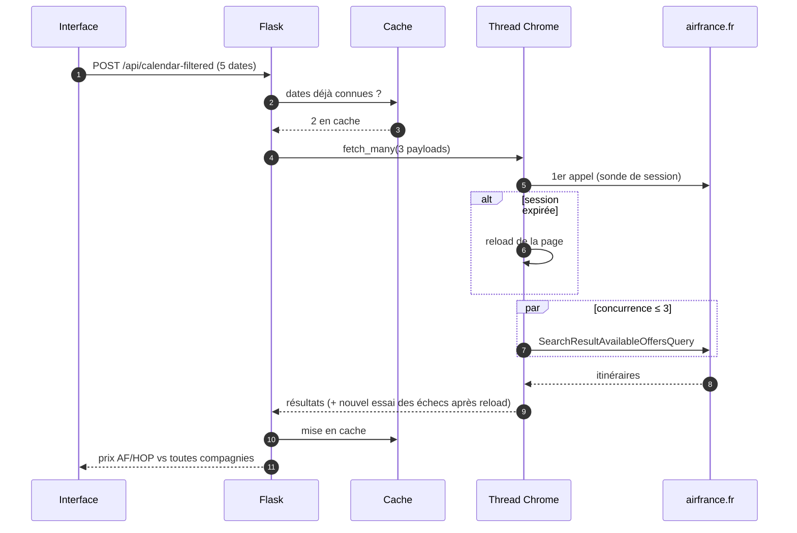

<div align="center">



<br>

[](https://github.com/RemiPelloux/AirFranceFilterScript/actions/workflows/ci.yml)


**Le calendrier « tarif le plus bas » d'airfrance.fr, mais seulement pour les vols _opérés_ par Air France et HOP.**

[Démarrage rapide](#-démarrage-rapide) · [Fonctionnement](#-fonctionnement) · [API](#-api) · [Configuration](#%EF%B8%8F-configuration) · [Sécurité](#-sécurité) · [Développement](#-développement) · [Changelog](CHANGELOG.md)

</div>

---

## 🎯 Pourquoi

Sur airfrance.fr, le calendrier affiche le prix le plus bas **toutes compagnies confondues** : un vol China Eastern ou un vol KLM via Amsterdam peut ainsi masquer le vrai tarif Air France. Le site ne propose aucun filtre « Air France uniquement ».

**AF Filter** interroge l'API GraphQL du site depuis une vraie session Chrome, récupère les itinéraires jour par jour et ne garde que ceux dont **chaque segment** est opéré par `AF` ou `A5` (HOP). Chaque jour affiche ensuite le meilleur prix AF/HOP, comparé au prix toutes compagnies.


## ✨ Fonctionnalités

| | |
|---|---|
| 📅 **Vue mensuelle** | Le prix le plus bas de chaque mois sur 12 mois. Un clic sur un mois ouvre la vue journalière. |
| 🗓️ **Vue journalière** | Le prix jour par jour, toutes compagnies (rapide) ou **filtré AF/HOP** (scan détaillé). |
| ⚡ **Affichage progressif** | Les cases du calendrier se remplissent au fil du scan. Le scan peut être **annulé** à tout moment. |
| 🧠 **Cache TTL** | Une date déjà scannée s'ouvre instantanément. Les lots déjà en cache s'enchaînent sans pause. |
| ✈️ **Détail des vols** | Segments, horaires, escales, numéros de vol, compagnies, et lien direct vers la réservation airfrance.fr. |
| 🖥️ **Terminal de logs** | Progression en direct pendant un scan : prix, écarts et erreurs. |
| 🔄 **Session auto-entretenue** | Rechargement après 8 min d'inactivité, puis rechargement et nouvel essai en cas d'échec. |
| 🟢 **Indicateur de session** | Pastille verte, jaune ou rouge, avec le nombre d'entrées en cache. |
| 🛡️ **Robuste** | Entrées validées (400), erreurs Air France typées (502/503/504), échappement HTML côté client. |

## 🚀 Démarrage rapide

**Prérequis :** Python ≥ 3.11 et Google Chrome installé.

```bash
git clone https://github.com/RemiPelloux/AirFranceFilterScript.git
cd AirFranceFilterScript
make install   # crée .venv, installe le paquet et le driver Chromium
make run       # ouvre Chrome puis sert l'interface sur http://127.0.0.1:5555
```

<details>
<summary>Sans <code>make</code></summary>

```bash
python3 -m venv .venv && source .venv/bin/activate
pip install -e .
python -m patchright install chromium
af-filter            # ou : python -m af_filter
```
</details>

> [!IMPORTANT]
> Une fenêtre Chrome **visible** s'ouvre sur airfrance.fr : laissez-la ouverte. Akamai détecte le mode headless.

## 🧩 Fonctionnement



1. **patchright** (fork furtif de Playwright) lance Chrome et charge airfrance.fr, ce qui fournit les cookies Akamai (`_abck`, `bm_sz`…).
2. Un **thread dédié** possède la page. L'API sync de Playwright est liée à son thread, donc Flask lui transmet ses jobs par une `queue.Queue`.
3. Chaque appel GraphQL s'exécute **dans la page** via `page.evaluate(fetch)`. Il est donc same-origin, avec les cookies valides.
4. Un **pool à concurrence bornée** (3 par défaut) envoie les lots. Chaque item est retenté avec un délai croissant, et une réponse non-2xx compte comme un échec.
5. Les réponses sont analysées par des fonctions **pures**, puis mises en **cache TTL/LRU** par `(route, date)`.



### Contournement Akamai

Akamai bloque les `POST /gql/v1` dont l'**URL** contient `SearchResultAvailableOffersQuery`. Or le backend Air France lit l'opération dans le **corps JSON**. Chaque appel utilise donc l'URL de l'opération « anodine » `SharedSearchLowestFareOffersForSearchQuery`, et le corps porte l'opération réelle.

| Requête GraphQL | Hash (persisted query) | Usage |
|---|---|---|
| `SharedSearchLowestFareOffersForSearchQuery` | `3129e428…` | Calendrier par mois ou par jour, toutes compagnies |
| `SearchResultAvailableOffersQuery` | `6c2316d3…` | Itinéraires d'une date avec les compagnies opérantes |

La première requête ne renvoie pas les compagnies opérantes, d'où le scan jour par jour avec la seconde pour filtrer AF/HOP.

## 🔌 API

| Méthode | Route | Description |
|---|---|---|
| `GET` | `/` | Interface web |
| `GET` | `/api/status` | État du navigateur, âge de la session, statistiques du cache |
| `POST` | `/api/calendar` | Calendrier `MONTH` / `DAY` (toutes compagnies) |
| `POST` | `/api/flights` | Itinéraires d'une date, triés par prix, filtre compagnie optionnel |
| `POST` | `/api/calendar-filtered` | Meilleur prix par date pour `airlineFilter` (défaut `AF`, `A5`), 31 dates max |

```bash
curl -s localhost:5555/api/calendar-filtered -H 'content-type: application/json' -d '{
  "origin": "PAR", "originType": "CITY",
  "destination": "NCE", "destinationType": "AIRPORT",
  "cabin": "ECONOMY", "passengers": 1,
  "dates": ["2027-01-10", "2027-01-11"]
}'
```

<details>
<summary>Codes d'erreur</summary>

| Code | Cause |
|---|---|
| `400` | Entrée invalide : code IATA, date, cabine, passagers (1 à 9)… ou en-tête `Host` non local |
| `502` | Air France a refusé ou renvoyé une erreur (ex. `HTTP 403` d'Akamai) |
| `503` | Navigateur pas prêt |
| `504` | Le navigateur n'a pas répondu à temps |

Dans `/api/calendar-filtered`, un échec sur une date n'interrompt pas le lot : il est signalé dans le champ `error` de cette date.
</details>

## ⚙️ Configuration

Toutes les variables sont optionnelles. Copiez `.env.example` vers `.env` : `make run` le charge automatiquement.

| Variable | Défaut | Rôle |
|---|---|---|
| `AFF_HOST` / `PORT` | `127.0.0.1` / `5555` | Adresse d'écoute |
| `AFF_HEADLESS` | `false` | Chrome sans fenêtre (détecté par Akamai) |
| `AFF_KEEPALIVE` | `480` | Secondes d'inactivité avant rechargement de la page |
| `AFF_BATCH_CONCURRENCY` | `3` | Requêtes parallèles dans la page |
| `AFF_BATCH_ITEM_DELAY_MS` | `350` | Délai entre deux items d'un lot |
| `AFF_MAX_RETRIES` / `AFF_RETRY_BACKOFF_MS` | `3` / `800` | Nouveaux essais par requête |
| `AFF_CACHE_TTL` / `AFF_CACHE_MAX` | `600` / `512` | Cache des réponses (`0` le désactive) |
| `AFF_LOG_LEVEL` | `INFO` | Verbosité des logs |

## 🗂️ Structure

```
AirFranceFilterScript/
├── src/af_filter/
│   ├── __main__.py          # point d'entrée (af-filter / python -m af_filter)
│   ├── config.py            # Settings depuis l'environnement, constantes AF
│   ├── models.py            # Route, TypedDicts, validation des entrées
│   ├── cache.py             # cache TTL + LRU thread-safe
│   ├── service.py           # cas d'usage : calendrier, vols, scan filtré
│   ├── browser/
│   │   ├── session.py       # thread Chrome, file de jobs, keepalive, retry
│   │   └── scripts.py       # JS du pool fetch exécuté dans la page
│   ├── gql/
│   │   ├── payloads.py      # corps GraphQL + liens de réservation
│   │   └── parsers.py       # parsing pur des réponses
│   └── web/
│       ├── app.py           # factory Flask, gestion des erreurs, en-têtes
│       ├── routes.py        # blueprint /api
│       └── static/          # index.html, css/, js/ (ES modules)
├── tests/                   # 39 tests pytest, avec une fausse session (sans Chrome)
├── .github/workflows/ci.yml # ruff, pip-audit et pytest sur Python 3.11 à 3.13
├── docs/assets/             # SVG animés du README
├── pyproject.toml           # paquet, dépendances, config ruff/pytest
├── CHANGELOG.md
├── Makefile                 # install · run · test · lint · format · audit
└── .env.example
```

## 🔒 Sécurité

L'API pilote une session Air France réelle. Elle est donc verrouillée en local :

- écoute sur `127.0.0.1` par défaut, **sans CORS**, donc un autre site ne peut pas l'appeler depuis votre navigateur ;
- `TRUSTED_HOSTS` limité à `127.0.0.1`, `localhost` et `::1` tant que l'écoute est locale, ce qui bloque le DNS rebinding ;
- corps JSON obligatoire, ce qui empêche les POST « simples » cross-site ;
- toutes les données affichées sont échappées, avec en-têtes `nosniff`, `X-Frame-Options: DENY` et `Referrer-Policy: no-referrer` ;
- `research/` (captures, cookies, prototypes) est exclu de git.

> [!WARNING]
> Si vous exposez l'API au réseau (`AFF_HOST=0.0.0.0`), la restriction `TRUSTED_HOSTS` est désactivée : n'importe qui sur ce réseau pourra utiliser votre session.

## 🛠️ Développement

```bash
make dev      # installe pytest, ruff et pip-audit
make check    # lint, format et tests (comme la CI)
make audit    # vulnérabilités connues des dépendances
make format   # formatage automatique
```

Les tests n'ouvrent jamais Chrome : `tests/conftest.py` fournit une `FakeSession` qui rejoue des réponses GraphQL et vérifie le parsing, le filtrage, le cache, la validation, les codes HTTP et la protection `Host`.

## 🩺 Dépannage

| Symptôme | Piste |
|---|---|
| `HTTP 403` sur toutes les dates | Akamai a signalé la session ou l'IP. Attendez quelques minutes, relancez, et baissez `AFF_BATCH_CONCURRENCY`. |
| Calendrier vide alors que le site affiche des prix | Les **hashes** des persisted queries ont peut-être changé : récupérez-les dans l'onglet Réseau d'airfrance.fr et mettez à jour `config.py`. |
| `Le navigateur n'a pas démarré` | Vérifiez que Chrome est installé, ou passez `AFF_BROWSER_CHANNEL=chromium` après `patchright install chromium`. |

## ⚠️ Limites

- **Chrome visible obligatoire** : le mode headless est détecté.
- **Un navigateur, une file** : les requêtes sont traitées en série par le thread Chrome. Un nouveau scan annule le précédent côté interface.
- **Dépendance au frontend Air France** : un changement de hash ou de schéma GraphQL casse les requêtes jusqu'à mise à jour.
- Projet personnel, sans lien avec Air France. Utilisez-le avec modération et dans le respect des conditions d'utilisation du site.
